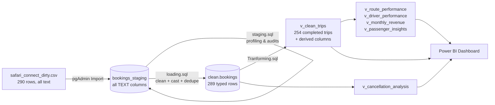

# Safari Connect — Bus & Matatu Booking Analytics

**End-to-end data analysis project: raw, messy CSV → PostgreSQL cleaning pipeline → SQL business analysis → Power BI board dashboard.**

Safari Connect is a Nairobi-based platform where passengers book long-distance bus, matatu and minibus seats and pay by M-Pesa, card or cash. For its first year the company kept every booking in a shared Excel file. The Operations Director handed over a CSV export and asked six questions: which routes make money, which drivers to promote, how revenue is trending, where passengers come from, what cancellations cost, and when the busiest travel times are.

This repository contains the whole workflow: data profiling, a 23-problem cleaning pipeline written in PostgreSQL, analysis queries that use CTEs and window functions, reporting views and indexes, and a two-page Power BI dashboard. A short write-up of every finding and recommendation follows.

---

## Table of Contents

1. [Executive Summary](#1-executive-summary)
2. [Tech Stack & Skills Demonstrated](#2-tech-stack--skills-demonstrated)
3. [Repository Structure](#3-repository-structure)
4. [Pipeline Architecture](#4-pipeline-architecture)
5. [The Raw Data](#5-the-raw-data)
6. [Data Profiling — What Was Wrong](#6-data-profiling--what-was-wrong)
7. [Data Cleaning — How It Was Fixed](#7-data-cleaning--how-it-was-fixed)
8. [Analysis Layer — `v_clean_trips`, Views & Indexes](#8-analysis-layer--v_clean_trips-views--indexes)
9. [Business Analysis — The 6 Questions](#9-business-analysis--the-6-questions)
10. [Power BI Dashboard](#10-power-bi-dashboard)
11. [Recommendations to the Board](#11-recommendations-to-the-board)
12. [Data Quality Caveats & Limitations](#12-data-quality-caveats--limitations)
13. [How to Reproduce](#13-how-to-reproduce)
14. [Next Steps](#14-next-steps)

---

## 1. Executive Summary

| KPI | Value |
|---|---|
| Raw rows received | **290** |
| Unique bookings after de-duplication | **289** |
| Completed trips | **254** (87.9%) |
| Cancelled / No-show | **21** (7.3%) / **14** (4.8%) |
| Revenue from completed trips | **KES 227,810** (seat-level) · KES 228,710 (booked `total_fare`) |
| Seats sold on completed trips | **452** |
| Revenue per seat | **KES 504** |
| Average passenger trip rating | **3.53 / 5** |
| Revenue lost to cancellations & no-shows | **KES 32,150** (12.3% of all booked value) |
| Period covered | 8 Jan 2024 – 4 Jan 2025 |

### Headline findings

1. **Three long-haul routes make 58.5% of revenue.** Nairobi→Mombasa (RT001) leads with KES 51,600 (22.7% of total) and earns KES 1,259 per seat. Nairobi→Eldoret and Nairobi→Kisumu follow.
2. **The most popular route earns the least per seat.** Nairobi→Thika (RT005) has the most bookings (30) and seats (62), but it earns only KES 123 per seat, one-tenth of what Mombasa earns.
3. **Cash bookings are the cancellation problem.** 21.3% of cash bookings are cancelled or no-shows. For M-Pesa the rate is 9.5% and for card it is 3.8%. Prepayment is the clearest policy lever available.
4. **Driver platform rating does not predict passenger satisfaction.** High-rated drivers (≥ 4.5) average a 3.38 trip rating and standard drivers average 3.62. The correlation is −0.10. The driver rating is measuring something other than how passengers feel about the trip.
5. **Revenue is growing, but it moves around a lot.** H2 2024 revenue was 12.8% higher than H1, and Q4 2024 was the best quarter (KES 64,665, up 17.2% on Q3). October was the best month (KES 24,190). August was the worst (KES 13,400, down 41% month on month).
6. **Safari Connect is a weekday, Nairobi-centred business.** Weekdays average 44 trips per day and weekends average 17. Nairobi residents make 44.5% of trips and 49.2% of revenue. Mornings (06:00–09:59) bring in 33.4% of revenue.

---

## 2. Tech Stack & Skills Demonstrated

| Area | Tools / Techniques |
|---|---|
| Database | **PostgreSQL** (pgAdmin): schemas, staging tables, typed production table |
| Data profiling | `DISTINCT` / `GROUP BY` audits, regex pattern classification (`~`), `HAVING` for duplicate detection |
| Data cleaning | `INITCAP`, `TRIM`, `REGEXP_REPLACE`, `CASE WHEN` mapping, `NULLIF`, `TO_DATE` with several format masks, `SPLIT_PART`, type casting |
| De-duplication | `ROW_NUMBER() OVER (PARTITION BY … ORDER BY ctid)` |
| Analysis | CTEs, `RANK()`, `LAG()`, running totals with `SUM() OVER (ORDER BY …)`, `% of total` with `SUM() OVER ()`, `NTILE(4)`, `CORR()`, conditional aggregation / pivots |
| Modelling for BI | `CREATE OR REPLACE VIEW` reporting layer, derived columns (month, weekday, satisfaction band), 7 indexes |
| Visualisation | **Power BI Desktop**: KPI cards, bar/column charts, line chart, donut, bubble/scatter, matrix table |
| Communication | Business questions → numbers → recommendations for a board audience |

---

## 3. Repository Structure

| File | Purpose |
|---|---|
| [`safari_connect_dirty.csv`](safari_connect_dirty.csv) | Raw export from Excel: 290 rows, 21 columns, deliberately messy |
| [`staging.sql`](staging.sql) | Builds the all-`TEXT` staging table and runs the **data profiling / audit** queries |
| [`Tranforming.sql`](Tranforming.sql) | Develops and tests each cleaning rule **one column at a time**, then creates the **`v_clean_trips`** analysis view |
| [`loading.sql`](loading.sql) | **Final production load**: one `INSERT … SELECT` that applies every cleaning rule and de-duplicates into `clean.bookings` |
| [`Safari.sql`](Safari.sql) | Working draft that combines the transform and load steps (kept for history; `loading.sql` is the version to run) |
| [`analysis.sql`](analysis.sql) | The **6 business questions**, the BI views (`v_route_performance`, `v_driver_performance`, `v_monthly_revenue`, `v_cancellation_analysis`, `v_passenger_insights`) and the 7 indexes |
| [`safari_connect_analysis.pbix`](safari_connect_analysis.pbix) | Power BI report file |
| [`safari_connect_analysis.pdf`](safari_connect_analysis.pdf) | PDF export of the dashboard |
| `safari connect page 1.png`, `safari_connect page 2.png` | Dashboard screenshots |
| `SafariConnect_Project_Brieff.docx` | Business brief from the Operations Director |
| `SafariConnect_DDL_Setup_Guide*.docx`, `SafariConnect_Day2_Analysis_Guide.docx` | Setup and analysis guides |

---

## 4. Pipeline Architecture

**Design decisions**

- **Everything lands in the staging table as `TEXT`.** Dates arrive in more than one format and fares arrive as text like `KES 1200`. Typed columns would reject those rows on import, so the raw data is loaded as text, profiled, and then cast.
- **The load is one idempotent `INSERT … SELECT`.** Staging is never modified with `UPDATE`, so the raw data stays available for auditing and the clean table can be rebuilt at any time.
- **Power BI reads views, not tables.** The views are the contract between SQL and BI. The same business logic (for example "revenue = completed trips only") applies to every visual.

---

## 5. The Raw Data

21 columns, one row per booking:

| Column | Meaning | Expected clean format |
|---|---|---|
| `booking_id` | Booking reference | `BK0001` … |
| `passenger_name`, `passenger_phone`, `passenger_gender`, `passenger_city` | Passenger details | Title Case · `07XXXXXXXX` · Male/Female · Title Case |
| `route_code`, `route_from`, `route_to` | Route (10 routes, `RT001`–`RT010`) | as-is |
| `vehicle_plate`, `vehicle_type` | Vehicle | Bus / Matatu / Minibus |
| `driver_name`, `driver_rating` | Driver and platform rating | Title Case · numeric |
| `departure_date`, `departure_time` | Schedule | `DATE` · `TIME` (12 slots, 06:00–21:00) |
| `seat_class`, `seats_booked` | Seat details | Economy / Business · positive integer |
| `fare_per_seat`, `total_fare` | Price in KES | numeric |
| `payment_method` | M-Pesa / Cash / Card | standardised |
| `booking_status` | Completed / Cancelled / No Show | standardised |
| `trip_rating` | Passenger rating | integer 1–5, blank if not rated |

---

## 6. Data Profiling — What Was Wrong

Before anything was cleaned, [`staging.sql`](staging.sql) audited every column. Key results:

| Column | Problem found | Scale |
|---|---|---|
| `passenger_name` | UPPERCASE, lowercase, leading/trailing spaces | 16 upper, 14 lower, 13 with extra whitespace, 54 distinct spellings of 24 real people |
| `passenger_gender` | 8 spellings: `Male`, `Female`, `FEMALE`, `F`, `MALE`, `female`, `male`, `M` | 13 non-standard rows |
| `passenger_city` | Mixed casing (`nairobi`, `NAIROBI` …) and blanks | 28 mis-cased, 13 blank |
| `passenger_phone` | Dashes (`0745-678-901`), blanks, leading zero dropped by Excel, `+254` numbers mangled into scientific notation (`2.54757E+11`) | 13 dashed, 13 blank, 249 nine-digit, 15 in scientific notation |
| `departure_date` | Two formats: `DD/MM/YYYY` (281) and `MM-DD-YYYY` (9) | 9 rows |
| `seat_class` | `economy`, `eco`, `ECO`, `economy class`, `BUS`, `business`, `BUSINESS CLASS` | 28 non-standard rows |
| `vehicle_type` | Lowercase variants | 13 rows |
| `driver_name` | UPPERCASE duplicates of 7 of the 8 drivers | 12 rows |
| `payment_method` | `mpesa`, `MPESA`, `m-pesa`, `CARD`, `CASH` … | 14 rows |
| `booking_status` | `COMPLETED`, `completed`, `NO SHOW`, `no show`, `CANCELLED` | 14 rows |
| `fare_per_seat`, `total_fare` | Stored as text with a `KES` prefix | 14 rows each |
| `trip_rating` | Out-of-range values `0`, `6`, `7` | 13 rows |
| `seats_booked` | A negative value (`-1`) | 1 row (`BK9002`) |
| `booking_id` | Exact duplicate record | `BK0005` × 2 |

---

## 7. Data Cleaning — How It Was Fixed

All rules are applied in a single pass in [`loading.sql`](loading.sql). Each rule was first built and tested on its own in [`Tranforming.sql`](Tranforming.sql).

| # | Problem | SQL technique |
|---|---|---|
| 1–3 | Name casing and whitespace | `INITCAP(REGEXP_REPLACE(TRIM(name), '\s+', ' ', 'g'))` also collapses internal double spaces |
| 4–6 | Phone dashes, `+254`, blanks | `CASE`: blank → `NULL`; `+254…` → `'0' ‖ SUBSTRING(digits, 4)`; otherwise strip non-digits with `REGEXP_REPLACE('[^0-9]')` |
| 7–9 | Mixed date formats | `CASE` on the pattern: `LIKE '%/%'` → `TO_DATE(…, 'DD/MM/YYYY')`; 8-char → `'DD-MM-YY'`; 10-char with middle part > 12 → `'MM-DD-YYYY'` |
| 10–12 | City casing and blanks | `CASE` over `LOWER(TRIM(city))` mapping to a whitelist of known cities; anything else → `NULL` (reported as *Unknown*). ⚠️ Machakos is missing from the whitelist in `loading.sql`, see §12 |
| 13 | 8 gender variants | `CASE WHEN LOWER(TRIM(g)) IN ('m','male') …` → `Male` / `Female` |
| 14 | Payment method casing | `CASE` → `mpesa` / `cash` / `card` |
| 15 | Booking status casing | `CASE UPPER(TRIM(status))` → `Completed` / `Cancelled` / `No Show` |
| 16–17 | Fares stored as `KES …` text | `NULLIF(REGEXP_REPLACE(fare, '[^0-9.]', '', 'g'), '')::NUMERIC(12,2)` |
| 18–19 | Seat class variants and abbreviations | `CASE` mapping `eco / economy / economy class` → `Economy`, `bus / business / business class` → `Business` |
| 20 | Driver name casing | Same `INITCAP` + `REGEXP_REPLACE` rule as passengers |
| 21 | Invalid ratings (0, 6, 7) | Only `'1'`–`'5'` are kept; everything else → `NULL` |
| 22 | Negative seats | Values `< 1` → `NULL` (the row is kept and flagged rather than deleted, so its booking stays in the status counts) |
| 23 | Duplicate booking | `ROW_NUMBER() OVER (PARTITION BY <all 21 columns> ORDER BY ctid)`, keep `row_num = 1` |

**Result:** 290 raw rows → **289 clean, strongly typed rows** in `clean.bookings`. After cleaning, every categorical column has exactly its expected set of values, and `total_fare = fare_per_seat × seats_booked` holds on every row where seats are valid (0 mismatches).

---

## 8. Analysis Layer — `v_clean_trips`, Views & Indexes

`v_clean_trips` ([`Tranforming.sql`](Tranforming.sql)) is the main analysis view. It contains **completed trips only** and adds these derived columns:

| Column | Logic |
|---|---|
| `travel_month`, `month_label`, `month_num` | `TO_CHAR` / `EXTRACT` on `departure_date` |
| `day_name`, `day_of_week` | Weekday name and number (0 = Sunday) |
| `calculated_fare` | `fare_per_seat * seats_booked`, the seat-level revenue used on the dashboard |
| `satisfaction` | 4–5 → *Satisfied*, 3 → *Neutral*, 1–2 → *Unsatisfied*, blank → *No Rating* |

[`analysis.sql`](analysis.sql) builds five reporting views on top of it: `v_route_performance`, `v_driver_performance`, `v_monthly_revenue`, `v_cancellation_analysis` (which reads `clean.bookings`, because cancelled rows are not in `v_clean_trips`) and `v_passenger_insights`. It also creates 7 indexes on the columns used for filtering and grouping: date, route, driver, status, payment, vehicle and city.

---

## 9. Business Analysis — The 6 Questions

Revenue figures below are completed-trip, seat-level revenue (`calculated_fare`), the same measure the dashboard uses, unless stated otherwise.

### Q1 · Route Analysis — *Which routes earn the most, which are most popular, which are most efficient?*

| Rank | Code | Route | Bookings | Seats | Revenue (KES) | % of total | Rev / seat | Avg rating |
|---|---|---|---|---|---|---|---|---|
| 1 | RT001 | Nairobi → Mombasa | 26 | 41 | **51,600** | 22.7% | **1,258.54** | 3.54 |
| 2 | RT004 | Nairobi → Eldoret | 27 | 51 | 43,200 | 19.0% | 847.06 | 3.50 |
| 3 | RT002 | Nairobi → Kisumu | 26 | 40 | 38,250 | 16.8% | 956.25 | **3.96** |
| 4 | RT007 | Nairobi → Nyeri | 28 | 52 | 22,200 | 9.7% | 426.92 | 3.23 |
| 5 | RT003 | Nairobi → Nakuru | 25 | 43 | 20,700 | 9.1% | 481.40 | 3.59 |
| 6 | RT010 | Nairobi → Naivasha | 25 | 52 | 15,120 | 6.6% | 290.77 | 3.33 |
| 7 | RT006 | Mombasa → Malindi | 22 | 40 | 14,350 | 6.3% | 358.75 | 3.60 |
| 8 | RT005 | Nairobi → Thika | **30** | **62** | 7,620 | 3.3% | 122.90 | 3.52 |
| 9 | RT008 | Kisumu → Kakamega | 25 | 38 | 7,470 | 3.3% | 196.58 | 3.52 |
| 10 | RT009 | Nairobi → Machakos | 20 | 33 | 7,300 | 3.2% | 221.21 | 3.50 |

**Findings**
- **Top route: RT001 Nairobi → Mombasa.** It has the highest revenue and the highest revenue per seat.
- **Top three routes (RT001, RT004, RT002) = KES 133,050, or 58.5% of revenue.** The business depends on long-haul routes.
- **Most popular route: RT005 Nairobi → Thika.** It has the most bookings and seats but earns only KES 122.90 per seat. It is a high-volume commuter route with little revenue per seat.
- **Clear underperformer: RT009 Nairobi → Machakos.** It has the lowest revenue, the fewest bookings, and the second-worst cancellation rate (16.7%).
- **Vehicle type (completed trips):** Matatu KES 87,925 (97 trips), Bus KES 84,555 (96 trips), Minibus KES 55,330 (61 trips). **Minibus trips get the best passenger rating (3.71)**, and buses carry the most seats per booking (1.93).

### Q2 · Driver Performance — *Who are the best drivers, and does driver rating affect satisfaction?*

| Overall rank | Driver | Vehicle | Trips | Seats | Revenue (KES) | Passenger rating | Platform rating | Lost-booking rate* |
|---|---|---|---|---|---|---|---|---|
| 1 | Isaac Korir | Matatu | 33 | 59 | **33,045** | 3.39 | 3.8 | 5.7% |
| 2 | Kelvin Omondi | Bus | 32 | 63 | 30,855 | 3.32 | 4.5 | 17.9% |
| 3 | Brian Kamau | Bus | 27 | 51 | 29,340 | 3.70 | 4.2 | **18.2%** |
| 4 | Tony Karanja | Matatu | 34 | 59 | 28,250 | 3.74 | 3.9 | **5.6%** |
| 5 | Samuel Gitonga | Minibus (+2 Bus) | 33 | 56 | 28,235 | 3.59 | 4.6 | 13.2% |
| 6 | Hassan Abdi | Minibus | 30 | 53 | 27,575 | **3.90** | 4.1 | 14.3% |
| 7 | Moses Kipchoge | Matatu | 30 | 46 | 26,630 | **3.19** | **4.8** | 14.3% |
| 8 | Peter Ngugi | Bus | 35 | 65 | 23,880 | 3.41 | 4.3 | 7.9% |

\* Share of that driver's bookings that ended as Cancelled or No Show (all 289 bookings).

**Does driver rating predict satisfaction?** No.

| Driver group | Drivers | Trips | Avg passenger trip rating |
|---|---|---|---|
| High-rated (≥ 4.5) | 3 | 95 | **3.38** |
| Standard (< 4.5) | 5 | 159 | **3.62** |

Pearson correlation between `driver_rating` and `trip_rating` is **−0.10**. The highest-rated driver on the platform, Moses Kipchoge (4.8), has the **lowest** passenger trip rating (3.19). The platform rating is not tracking what passengers actually experience.

**Promotion recommendation: Tony Karanja.** He has the 4th-highest revenue (KES 28,250), the most trips of any Matatu driver (34), the second-best passenger rating (3.74) and the **lowest lost-booking rate (5.6%)**. He does well on revenue, satisfaction and reliability at the same time. **Isaac Korir** (top revenue, 5.7% lost bookings) should be recognised as a revenue leader. **Hassan Abdi** is the benchmark for passenger satisfaction (3.90).

*Caveat:* the drivers work in two fixed pools. Kelvin, Moses, Hassan and Peter cover RT001/003/005/007/009. Isaac, Tony, Brian and Samuel cover RT002/004/006/008/010. Some of a driver's revenue therefore comes from the route mix they are assigned, not only from their performance.

### Q3 · Revenue Trends — *How is revenue changing month by month?*

| Month | Trips | Revenue (KES) | MoM % | Running total |
|---|---|---|---|---|
| 2024-01 | 19 | 17,675 | — | 17,675 |
| 2024-02 | 21 | 16,980 | −3.9% | 34,655 |
| 2024-03 | 20 | 19,005 | +11.9% | 53,660 |
| 2024-04 | 19 | 15,720 | −17.3% | 69,380 |
| 2024-05 | 24 | 18,510 | +17.7% | 87,890 |
| 2024-06 | 20 | 18,380 | −0.7% | 106,270 |
| 2024-07 | 21 | 22,855 | +24.3% | 129,125 |
| 2024-08 | 15 | **13,400** | **−41.4%** | 142,525 |
| 2024-09 | 24 | 18,935 | +41.3% | 161,460 |
| 2024-10 | 24 | **24,190** | +27.8% | 185,650 |
| 2024-11 | 21 | 20,270 | −16.2% | 205,920 |
| 2024-12 | 23 | 20,205 | −0.3% | 226,125 |
| 2025-01* | 3 | 1,685 | n/a | 227,810 |

\* January 2025 only contains data for 1–4 January, so it is a partial month and not a real decline.

**Findings**
- **Best 3 months:** October (KES 24,190), July (22,855), November (20,270).
- **Worst 3 months:** August (13,400), April (15,720), February (16,980).
- **Trend direction: growing, with large swings.** By quarter: Q1 53,660 → Q2 52,610 → Q3 55,190 → **Q4 64,665 (+17.2% QoQ)**. H2 2024 was **12.8% higher than H1**.
- The August dip (−41%) followed by a September recovery (+41%) looks like a seasonal slowdown. It is worth checking against school calendars and fleet availability for that month.

### Q4 · Passenger Insights — *Where do passengers come from, what do they buy, are they happy?*

**Home cities (completed trips)**

| City | Trips | % of trips | Revenue (KES) | Avg booking value |
|---|---|---|---|---|
| Nairobi | 113 | 44.5% | 112,000 | 991 |
| Kisumu | 26 | 10.2% | 20,980 | 807 |
| Eldoret | 24 | 9.4% | 13,910 | 580 |
| Mombasa | 21 | 8.3% | 21,320 | 1,058 |
| Meru | 14 | 5.5% | 11,655 | 833 |
| Nakuru | 13 | 5.1% | 6,300 | 485 |
| Thika | 13 | 5.1% | 16,740 | **1,288** |
| Unknown (blank in source) | 11 | 4.3% | 9,425 | 857 |
| Nyeri | 10 | 3.9% | 8,220 | 822 |
| Machakos | 9 | 3.5% | 7,260 | 807 |

**Gender and seat class**

| | Trips | Economy | Business | Revenue (KES) | Avg rating |
|---|---|---|---|---|---|
| Female | 138 (54.3%) | 109 | 29 | 120,885 | 3.52 |
| Male | 116 (45.7%) | 93 | 23 | 106,925 | 3.54 |

| Seat class | Share of trips | Share of revenue | Avg fare / seat | Avg rating |
|---|---|---|---|---|
| Economy | 79.5% | 83.2% | KES 500 | 3.50 |
| Business | 20.5% | 16.8% | KES 705 | 3.65 |

**Satisfaction**

| Band | Trips | % |
|---|---|---|
| Satisfied (4–5) | 117 | **46.1%** |
| Neutral (3) | 74 | 29.1% |
| Unsatisfied (1–2) | 49 | 19.3% |
| No rating | 14 | 5.5% |

**Findings**
- **Nairobi is the core market**: 44.5% of trips and 49.2% of revenue. Thika residents spend the most per booking (KES 1,288).
- **The customer base is small and loyal**: 24 unique passengers averaging 10.6 trips each. The **top quartile (6 passengers) generates 42.8% of revenue**. Alice Mwangi alone took 17 trips worth KES 23,370. A loyalty programme is low-cost and would protect this revenue.
- **Fewer than half of trips produce a satisfied customer (46.1%)**, and nearly 1 in 5 are rated unsatisfied. **Nairobi → Nyeri** has the weakest satisfaction (3.23 average, only 30.8% satisfied) even though it is the second most-booked route. **Nairobi → Kisumu** is the best (3.96, 69.2% satisfied).
- Business class passengers pay 41% more per seat and are slightly happier (3.65 vs 3.50).
- **M-Pesa is the dominant payment method**: 52.8% of completed trips, followed by Cash 27.6% and Card 19.7%.

### Q5 · Cancellations — *What is the cancellation rate and what does it cost?*

| Status | Bookings | % | Booked value (KES) |
|---|---|---|---|
| Completed | 254 | 87.89% | 228,710 |
| Cancelled | 21 | 7.27% | **24,805** |
| No Show | 14 | 4.84% | **7,345** |

**Total revenue lost: KES 32,150**, which is 12.3% of all booked value.

| Route | Bookings | Cancelled | No Show | Lost rate | Lost KES |
|---|---|---|---|---|---|
| RT006 Mombasa → Malindi | 27 | 1 | 4 | **18.5%** | 2,800 |
| RT009 Nairobi → Machakos | 24 | 1 | 3 | 16.7% | 2,000 |
| RT005 Nairobi → Thika | 35 | 3 | 2 | 14.3% | 1,140 |
| RT003 Nairobi → Nakuru | 29 | 2 | 2 | 13.8% | 3,150 |
| RT008 Kisumu → Kakamega | 29 | 3 | 1 | 13.8% | 1,620 |
| RT001 Nairobi → Mombasa | 30 | 4 | 0 | 13.3% | **10,800** |
| RT002 Nairobi → Kisumu | 29 | 3 | 0 | 10.3% | 5,400 |
| RT007 Nairobi → Nyeri | 31 | 2 | 1 | 9.7% | 2,800 |
| RT010 Nairobi → Naivasha | 27 | 1 | 1 | 7.4% | 840 |
| RT004 Nairobi → Eldoret | 28 | 1 | 0 | **3.6%** | 1,600 |

| Payment method | Bookings | Lost-booking rate |
|---|---|---|
| **Cash** | 89 | **21.3%** |
| M-Pesa | 148 | 9.5% |
| Card | 52 | 3.8% |

**Findings**
- **Worst route by rate: RT006 Mombasa → Malindi (18.5%)**, driven mostly by no-shows.
- **Worst route by money: RT001 Nairobi → Mombasa**. Its 4 cancellations cost KES 10,800, which is **one-third of all lost revenue**, because its fares are the highest.
- **Cash is the root cause.** A cash booking is **5.6× more likely** to be lost than a card booking and **2.2×** more likely than an M-Pesa booking. Passengers with nothing paid up front have no reason to show up.
- By vehicle type, Matatus lose the fewest bookings (8.5%), compared with Bus (14.3%) and Minibus (14.1%).

### Q6 · Operational Patterns — *When are we busiest, and when should we add vehicles?*

| Day | Trips | Seats | Revenue (KES) | Avg booking |
|---|---|---|---|---|
| Monday | 45 | 88 | **47,350** | **1,052** |
| Tuesday | 48 | 82 | 44,505 | 927 |
| Wednesday | **49** | 81 | 36,300 | 741 |
| Thursday | 44 | 79 | 42,510 | 966 |
| Friday | 34 | 59 | 30,390 | 894 |
| Saturday | 23 | 46 | 18,720 | 814 |
| Sunday | 11 | 17 | 8,035 | 812 |

| Time band | Trips | Seats | Revenue (KES) | % of revenue |
|---|---|---|---|---|
| **Morning 06:00–09:59** | 92 | 164 | 76,045 | **33.4%** |
| Midday 10:00–13:59 | 61 | 106 | 52,515 | 23.1% |
| Afternoon 14:00–17:59 | 57 | 102 | 56,490 | 24.8% |
| Evening 18:00+ | 44 | 80 | 42,760 | 18.8% |

**Findings**
- **Peak period: Monday–Thursday mornings.** Weekdays average **44 trips per day**, against **17** on weekends. Monday brings in the most revenue and has the highest-value bookings, which fits start-of-week long-haul travel.
- **Top individual slots:** 19:00 (KES 22,240, the overnight long-haul departures), 09:00 (most bookings, 25) and 10:30. **13:00 is the weakest slot** (KES 12,045).
- **All vehicle types run "Low Load"** (average 1.7–1.9 seats per booking). There is spare capacity, so the growth lever is more bookings per departure, not more vehicles.

---

## 10. Power BI Dashboard

Power BI Desktop connects to the PostgreSQL reporting views. The report has two pages.

### Page 1 — Business Overview

| Visual | What it answers |
|---|---|
| KPI cards: Total Revenue (228.71K), Total Bookings (289), Completed Bookings (254), Cancellation Rate, Average Fare, Average Trip Rating (3.53) | The headline health check |
| Monthly Revenue (line) | Q3: revenue trend |
| Revenue by route (bar) | Q1: route ranking; Nairobi → Mombasa is clearly the leader |
| Booking Status (donut) | Q5: 87.89% completed / 7.27% cancelled / 4.84% no-show |
| Revenue by vehicle type (column) | Q1D: Matatu ≈ Bus > Minibus |
| Bookings vs revenue by route (bubble) | Q1: volume vs value. Thika sits bottom-right (high volume, low value) and Mombasa top-centre (high value) |

### Page 2 — Route & Revenue Deep-Dive

| Visual | What it answers |
|---|---|
| KPI cards: Total Revenue (227.81K), Total Bookings (254 completed), Revenue per Seat (504.00), Average Fare, Average Rating | Efficiency view of completed trips |
| Revenue by route and Total bookings by route (bars) | Popularity next to profitability. The two rankings are almost reversed |
| Revenue by vehicle type (column) | Fleet mix |
| MoM % (line) | Q3: month-over-month growth |
| Route matrix (bookings, seats, avg fare, avg rating, revenue) | Full Q1 table. Its values match the SQL output in §9 exactly |
| Revenue and Bookings by route (scatter) | Volume vs value, without bubble sizing |

### Reconciling the SQL with the dashboard

Every dashboard number was re-derived in SQL. The small differences between pages have known causes:

| Dashboard figure | Explanation |
|---|---|
| Revenue **228.71K** (p1) vs **227.81K** (p2) | Page 1 sums the booked `total_fare`. Page 2 sums `calculated_fare = fare_per_seat × seats_booked`. The KES 900 gap is booking `BK9002`, whose invalid seat count (−1) was set to `NULL` |
| Average Fare **535.63** | This is the average of the 10 route averages. The true mean fare per seat across all 254 trips is **KES 542.01** |
| Cancellation Rate **12.14** | This is the average of the 10 route-level rates. The pooled rate is 35 / 289 = **12.11%** |
| Monthly Revenue / MoM % line charts look like a steady decline | The x-axis is sorted **by revenue value, not by date** (2024-10, 2024-07, 2024-11 …), so the line always slopes down. Sorted by date, revenue is flat-to-growing (§9 Q3). The fix is to sort by `travel_month` ascending |
| Page 2 revenue by vehicle (Bus ≈ 102K) | This visual includes cancelled and no-show bookings (all 289 rows). Page 1 and §9 use completed trips only |

---

## 11. Recommendations to the Board

| # | Recommendation | Evidence | Expected impact |
|---|---|---|---|
| 1 | **Require a deposit or prepayment for cash bookings** (for example an M-Pesa deposit at booking) | Cash bookings are lost 21.3% of the time vs 3.8% for card | Bringing cash down to the M-Pesa rate would recover about 10 of the 19 lost cash bookings, roughly KES 6K a year (cash losses total KES 11,385) |
| 2 | **Protect and grow the long-haul routes.** Add departures on Nairobi → Mombasa / Eldoret / Kisumu at the Monday–Thursday morning and 19:00 peaks | 58.5% of revenue; RT001 earns KES 1,259 per seat | Highest-return use of any new capacity |
| 3 | **Tighten the no-show policy on RT001 and RT006.** Send reminder SMS and charge a no-show fee | RT001 lost KES 10,800; RT006 has an 18.5% lost rate | Directly reduces the KES 32,150 leakage |
| 4 | **Reprice or bundle short commuter routes** (Thika, Machakos, Kakamega), for example with multi-trip commuter passes | Thika has the most volume but earns KES 123 per seat | Improves margin without losing volume |
| 5 | **Promote Tony Karanja.** Use Hassan Abdi's service style as the training benchmark | Tony: top-4 revenue, 3.74 rating, 5.6% lost rate. Hassan: 3.90 rating | Rewards balanced performance, not revenue alone |
| 6 | **Redesign the driver rating**, or replace it with the passenger trip rating in driver KPIs | Correlation −0.10; the top-rated driver has the lowest trip rating | Driver incentives would then follow real customer satisfaction |
| 7 | **Fix Nairobi → Nyeri service quality.** Audit the vehicles, punctuality and drivers on this route | 2nd most-booked route, worst satisfaction (30.8% satisfied) | Protects a high-volume route from churn |
| 8 | **Launch a loyalty programme for top spenders** | Top 25% of passengers = 42.8% of revenue | Retention of the most valuable customers |
| 9 | **Fill weekend and midday seats with off-peak pricing** instead of adding vehicles | Weekends average 17 trips/day vs 44 on weekdays; every vehicle type is "Low Load" | Better use of the existing fleet |

---

## 12. Data Quality Caveats & Limitations

These are documented openly so the numbers can be defended in front of the board:

- **Phone numbers cannot be fully recovered.** Excel stored the `+254…` numbers in scientific notation (`2.54757E+11`, 15 rows). This lost the last digits permanently. It also removed the leading `0` from 249 numbers. The current rule strips non-digits, so these rows need a follow-up rule: set scientific-notation values to `NULL` and add back the leading `0` on 9-digit values. Phone numbers are not used in any of the analysis.
- **Blank cities (13 rows)** are kept as `NULL` and reported as *Unknown* instead of being guessed.
- **Machakos city bug.** The city `CASE` in `loading.sql` lists 8 cities but leaves out **Machakos**, so its 12 raw rows (9 completed trips) become `NULL`. The city table in §9 maps Machakos correctly. Add `WHEN LOWER(TRIM(passenger_city)) = 'machakos' THEN 'Machakos'`, or use `INITCAP(TRIM(passenger_city))` together with `NULLIF(…, '')`.
- **Invalid ratings (0/6/7)** are set to `NULL`, so 14 completed trips have *No Rating*.
- **`BK9002` (−1 seats)** is kept with `NULL` seats rather than deleted, so its booking status still counts in the status totals.
- **Small sample.** There are 289 bookings from 24 unique passengers over about 12 months. The trends point in a direction but are not statistically robust. Month-level swings of ±40% are expected at 15–24 trips per month.
- **Partial final month.** January 2025 has only 4 days of data.
- **Script housekeeping.** `loading.sql` is the tested final load. The combined draft in `Safari.sql` is missing a comma after `driver_rating` (line 573), and `Tranforming.sql` is missing a semicolon after the payment-method query (line 162). The payment rule outputs lowercase `mpesa` / `cash` / `card`. Title Case (`M-Pesa`, `Cash`, `Card`) would match the brief.

---

## 13. How to Reproduce

**Prerequisites:** PostgreSQL 14+ with pgAdmin, and Power BI Desktop.

1. **Create the staging table.** Run [`staging.sql`](staging.sql) (run `SET search_path TO safari_connect;` first so the staging table is created in the `safari_connect` schema).
2. **Import the CSV.** In pgAdmin, right-click `bookings_staging` → *Import/Export Data* → `safari_connect_dirty.csv` (header on). Check it with `SELECT COUNT(*) FROM bookings_staging; -- 290`.
3. **Profile the data** with the audit queries in `staging.sql`.
4. **Clean and load.** Run [`loading.sql`](loading.sql). Check it with `SELECT COUNT(*) FROM clean.bookings; -- 289`.
5. **Create the analysis view.** Run the `v_clean_trips` block at the end of [`Tranforming.sql`](Tranforming.sql).
6. **Analyse.** Run [`analysis.sql`](analysis.sql) for the 6 questions, the 5 BI views and the 7 indexes.
7. **Visualise.** Open [`safari_connect_analysis.pbix`](safari_connect_analysis.pbix) → *Transform data* → *Data source settings* → point it at your server (`localhost`, database `postgres`), then *Refresh*.

---

## 14. Next Steps

- Make the phone-cleaning rule restore the leading `0` and set unrecoverable scientific-notation values to `NULL`.
- Add a date dimension table in Power BI and sort month axes by date (`travel_month`) instead of by value, so the trend lines read left to right in time order.
- Add drill-throughs from route to driver to time slot, and a separate cancellations page.
- Move the monthly load into a scheduled job so the dashboard refreshes automatically as new bookings arrive.

---

**Author:** Mwaivictor · Data Analyst: SQL (PostgreSQL) · Power BI
